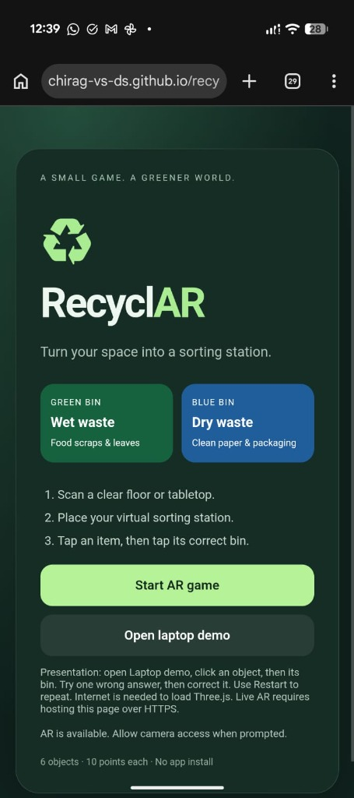
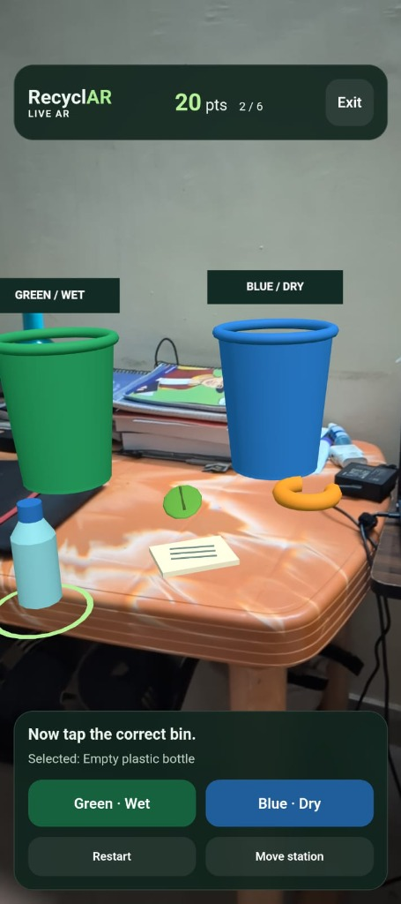

# RecyclAR

A small, genuine browser AR waste-sorting practical using JavaScript, Three.js and WebXR. No Unity, paid API, backend database, build step or model downloads. Three.js is loaded from a pinned CDN URL; internet access is required.

## Screenshots

<p align="center">
  
  &nbsp;&nbsp;&nbsp;&nbsp;
  
</p>

## What is included

- Real-world horizontal surface detection using WebXR hit testing.
- A live camera view supplied by the XR compositor, with a green placement ring.
- Two procedural 3D bins: green for wet waste, blue for dry waste.
- Six small 3D waste objects: apple core, leaf, orange peel, empty plastic bottle, clean paper and empty can.
- Tap an object, then tap a 3D bin (or its accessible on-screen button).
- 10 points per correct object; wrong choices display an explanation and retain the object. Maximum 60 points; incorrect attempts are counted without subtracting points.
- Animated sorting, completion message, restart, reposition and exit controls.
- Unsupported-device and permission-error messages. There is no simulated desktop AR mode.

This MVP implements **tap-to-sort**, not drag-and-drop. It does not recognize physical rubbish: the waste is virtual, and its category is predefined. The simplified two-bin teaching scheme excludes hazardous, sanitary and electronic waste.

## Project structure

| File | Purpose |
| --- | --- |
| `index.html` | Welcome screen, AR overlay, pinned Three.js import map |
| `style.css` | Responsive phone layout and feedback styles |
| `src/app.js` | XR session, hit tests, placement, raycasting, interaction, animation |
| `src/models.js` | Lightweight bins, objects and labels built from geometry |
| `src/game.js` | Object categories and scoring rules |
| `server.mjs` | Dependency-free local development server |
| `tests/game.test.mjs` | Scoring, retry, duplicate and restart checks |
| `package.json` | Start and test commands |
| `.nojekyll` | Static GitHub Pages deployment marker |
| `LICENSE` | MIT license for this project |

## Requirements

1. A compatible **ARCore-supported Android phone** and Android Chrome with WebXR immersive AR support. Ensure Google Play Services for AR is installed and updated. The game requires both `hit-test` and `dom-overlay` features.
2. A secure context: a public **HTTPS** URL, or localhost forwarded through USB for development.
3. Camera/AR permission when Chrome requests it.
4. Internet to fetch Three.js. Nothing is uploaded by the game; there is no analytics or camera recording in the project.

Desktop Chrome normally shows the welcome screen and an AR-unavailable message. A webcam alone cannot supply WebXR surface tracking. Android support varies by hardware and browser; iPhone Safari is not a target for this MVP.

## Quick start on your laptop

1. Extract the ZIP.
2. Install Node.js (version 18 or newer) if you do not already have it.
3. Open a terminal in the `RecyclAR` folder containing `package.json`.
4. Run:

```sh
npm start
```

5. Open `http://localhost:8080` to inspect the welcome page.

There are no npm dependencies, so `npm install` is unnecessary. Stop the server with Ctrl+C. If port 8080 is in use, stop the other server or change the port in `server.mjs` and in your USB forwarding settings.

Do not double-click `index.html`. ES modules must be served through HTTP/HTTPS. A phone opening `http://192.168.x.x:8080` is not in a secure context; simply using the same Wi-Fi is insufficient for AR. The included server intentionally listens on localhost.

## Free deployment: GitHub Pages

No Node.js server is needed in production; these are static files.

1. Sign in to GitHub and create a **public** repository named `recyclar` (public repositories support Pages on GitHub Free).
2. Use **Add file → Upload files**, and upload the **contents** of the extracted `RecyclAR` directory. `index.html` must be at the repository root, alongside `style.css` and `src/`. Do not upload only the ZIP or nest everything inside another RecyclAR directory.
3. Commit the files to `main`.
4. Open **Settings → Pages**. Under Build and deployment, choose **Deploy from a branch**, select `main`, choose `/ (root)`, and save.
5. Wait for the deployment to complete. Open the URL GitHub shows, normally `https://YOUR-USERNAME.github.io/recyclar/`.
6. Open that HTTPS link **directly in Android Chrome**, not in a social-media in-app browser or embedded preview.
7. Tap **Start AR game** and allow access. No API key or billing account is required.

Keep `.nojekyll` if uploading through Git; it is harmless if your web uploader omits it because this project contains no Jekyll-specific paths. Updates are deployed by committing changed files to the same branch. If the old version remains visible, reload the phone tab.

Alternative: any static hosting service serving the same folder over trusted HTTPS works. There is no build command; publish the folder containing `index.html`. Open the deployed page as a top-level tab. Embedding it requires extra XR Permissions Policy configuration and is outside this MVP.

## Test on a phone without deploying (USB)

1. Run `npm start` on the laptop.
2. Enable Developer options and USB debugging on Android; connect the phone using a data-capable USB cable and approve its debugging prompt.
3. Open desktop Chrome and go to `chrome://inspect/#devices`.
4. Check **Discover USB devices**. Once the phone appears, choose **Port forwarding**.
5. Forward device port `8080` to `localhost:8080`, and enable forwarding.
6. On the phone, open Chrome at `http://localhost:8080` while connected. Forwarded localhost is the development secure-context exception.
7. Tap Start AR game. Disable USB debugging after development if desired.

## How to play / practical demonstration

1. Stand still near a clear, textured, well-lit floor or a sufficiently large tabletop. The arrangement uses roughly 60 × 60 cm.
2. Start AR and point the camera downward. Slowly move it sideways so ARCore can estimate the surface.
3. A green ring appears when a suitable upward horizontal surface is detected. Aim the ring at the centre of the intended station area.
4. Tap **Place station here**. The station is placed at the real hit-test position and faces your initial viewpoint.
5. Tap a virtual object. Its selection ring lights up; its name appears on screen.
6. Tap the matching 3D bin, or choose **Green · Wet** / **Blue · Dry**. On a wrong answer, read the explanation and retry.
7. Sort all six objects for 60 points. **Restart** resets the same station; **Move station** resets the round and begins surface scanning again. **Exit** ends AR and releases the XR session.

## How the AR works (viva notes)

`navigator.xr.requestSession('immersive-ar', ...)` requests actual immersive AR. Three.js connects its WebGL renderer to this session. A viewer-space hit-test source sends a ray into the environment; each XR frame reports where that ray intersects tracked real geometry. The code accepts upward surfaces within roughly 20 degrees of horizontal and displays a reticle at the returned pose.

Placement copies the hit-test position into a Three.js group in the XR `local` reference space. The camera is driven by phone tracking, so the group remains in that tracked space as the phone moves. Three.js renders transparent pixels around the objects; the XR compositor supplies the camera background. No `getUserMedia` video background or pretend plane is substituted.

Touch `select` events supply a transient input ray. Raycasting that ray against virtual objects determines the selected item/bin. DOM overlay controls cancel `beforexrselect` to prevent the same tap from also hitting the 3D scene. Correct answers animate locally, while pure JavaScript rules update the score.

Limitations: placement uses session-local tracking, not persistent anchors; it may drift and does not survive exiting AR. There is no real-world occlusion, depth masking, physics, automatic object recognition or explicit plane-boundary visualization. A hit confirms a surface point, not that the entire station fits on a tabletop. Move the station if any objects extend past the surface edge.

## Troubleshooting

| Symptom | What to check |
| --- | --- |
| AR unavailable | Use compatible Android hardware, Chrome, updated Google Play Services for AR and HTTPS. |
| AR cannot start | Allow camera/AR permissions; close other AR tabs/apps; open the page directly. The browser must support hit-test and DOM overlay. |
| No green ring | Point down, move slowly, use good lighting and a textured surface. Blank/glossy surfaces can fail. |
| Tracking paused | Point back at the original surface. Rescan if tracking cannot recover. |
| Object is hard to tap | Move closer; first select the object, then use the on-screen bin button. |
| Models drift | This is session-local AR tracking. Improve lighting and tap Move station. |
| Game cannot load | Check internet/CDN access. Three.js is fetched from jsDelivr; retry after reloading. |
| GitHub page gives 404 | Ensure index.html is at the selected publishing root and Pages deployment has finished. |

## Validation

Run `npm test` to execute four game-rule tests. Syntax checks: `node --check src/app.js` and `node --check src/models.js`.

Before presenting, run this **physical phone checklist**; automated rule tests cannot validate real surface detection:

- [ ] HTTPS start and permission prompt succeed.
- [ ] Green ring appears on a floor/table; placement is disabled when it disappears.
- [ ] Station stays approximately at the placement point when walking slowly around it.
- [ ] Each of the six objects can be selected; both 3D bins and DOM bin buttons work.
- [ ] Incorrect sorting leaves the object present and shows red feedback.
- [ ] Correct sorting gives exactly 10 points once and removes the object.
- [ ] Six correct sorts produce 60 points and a completion message.
- [ ] Restart clears score and mistakes; Move station allows new placement.
- [ ] Exit and re-enter work without old models or scores.
- [ ] Tracking loss gives a message and does not allow sorting until tracking returns.

This delivered version has passed the included rule tests and JavaScript syntax checks. Real-device AR tracking has not been validated during creation; complete the checklist on your phone before the practical.

## Customize

Edit labels/categories in `src/game.js`, geometry in `src/models.js`, and colors/layout in `style.css`. If adding items, also update initial UI counts in `index.html` and completion maximum in `src/app.js`. Geometry is intentionally low-poly and generated locally. Three.js is pinned to `0.170.0` so later CDN releases do not silently change the app.

## Official references

- WebXR requirements: https://developers.google.com/ar/develop/webxr/requirements
- Supported Android devices: https://developers.google.com/ar/devices
- Three.js hit-test example: https://threejs.org/examples/webxr_ar_hittest.html
- XR select events: https://developer.mozilla.org/en-US/docs/Web/API/XRSession/select_event
- USB forwarding: https://developer.chrome.com/docs/devtools/remote-debugging/local-server
- GitHub Pages setup: https://docs.github.com/en/pages/getting-started-with-github-pages/creating-a-github-pages-site

Project code is MIT licensed. Three.js is separately MIT licensed: https://github.com/mrdoob/three.js/blob/r170/LICENSE . No paid assets are used.
